

# Perihan Özbay · Portfolio MVC

**ASP.NET Core MVC · Entity Framework Core · SQL Server**

Veritabanı destekli kişisel portfolyo ve içerik yönetim paneli  
**M&Y Yazılım Eğitim Akademi · 12. Dönem Akşam Grubu · CASE 01**

[Portfolyo](#-portfolyo-arayüzü) · [Admin Paneli](#-yönetim-paneli) · [Teknolojiler](#-teknolojiler) · [Kurulum](#-yerel-kurulum)

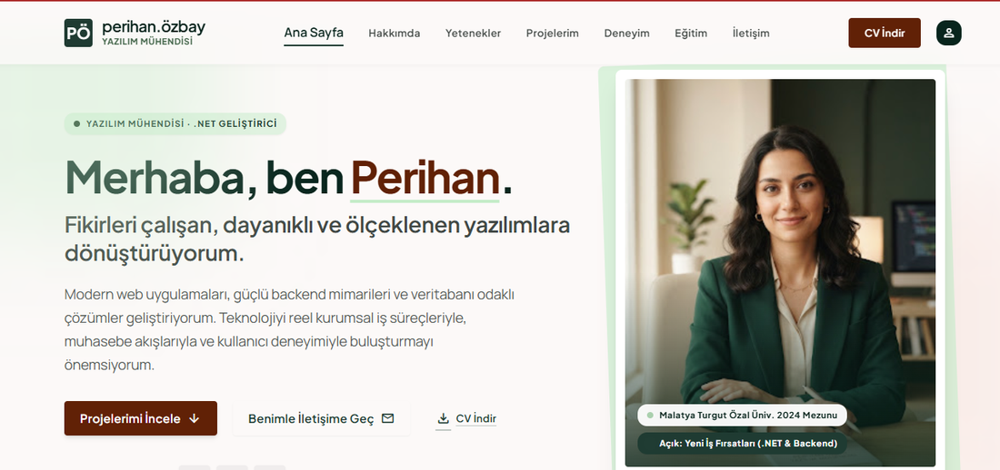

## 📌 Proje Hakkında

Bu çalışma, mevcut portfolyo arayüzü ve yönetim tasarımını **ASP.NET Core MVC**, **Entity Framework Core (Code First)** ve **SQL Server** ile dinamik hale getirmeyi amaçlar. Public sayfa **ViewComponent** bileşenlerine ayrılmıştır; içerik yönetimi **Admin Area** üzerinden gerçekleştirilir.

> Akademi projesidir. Ekranlarda yer alan bazı proje kayıtları örnek/demo içeriklerdir.

## 🖥️ Portfolyo Arayüzü

| Hakkımda | Teknik yetenekler |
|:--:|:--:|
| 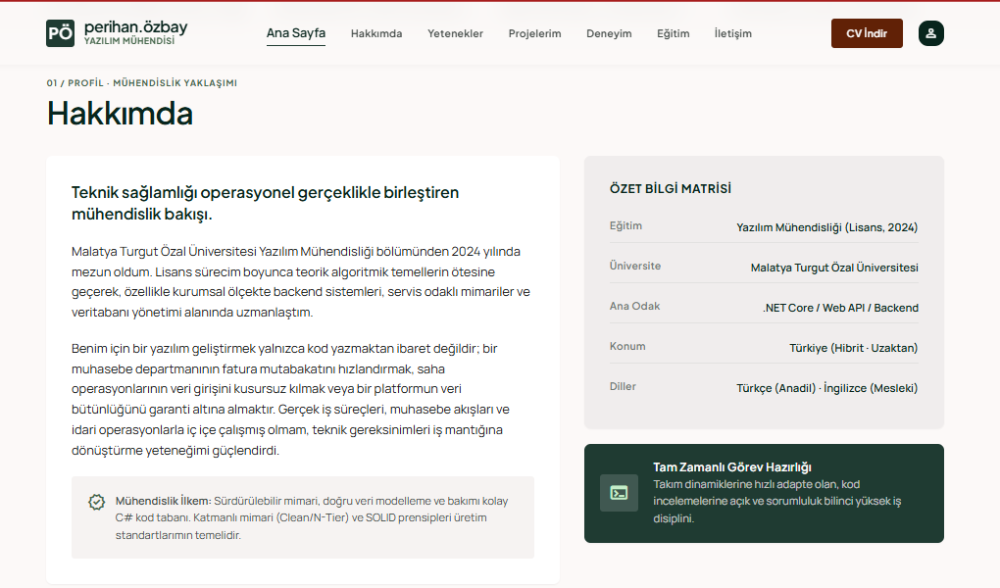 | 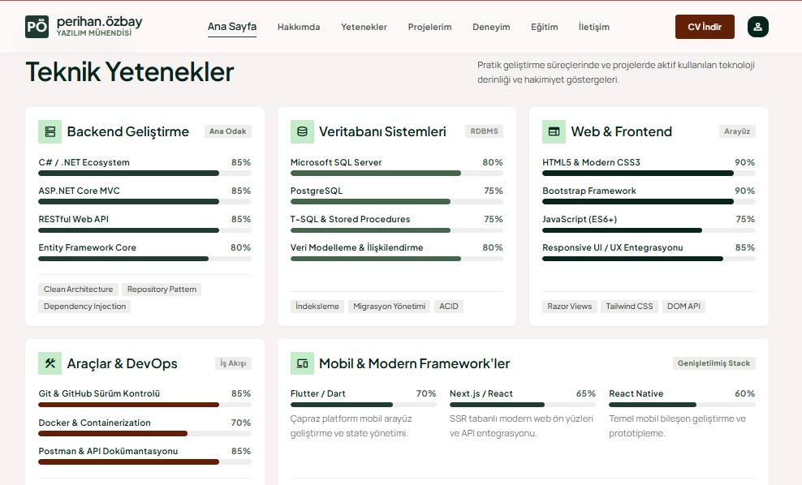 |

**Öne çıkan projeler:** Proje kartları, teknoloji etiketleri ve proje açıklamaları.

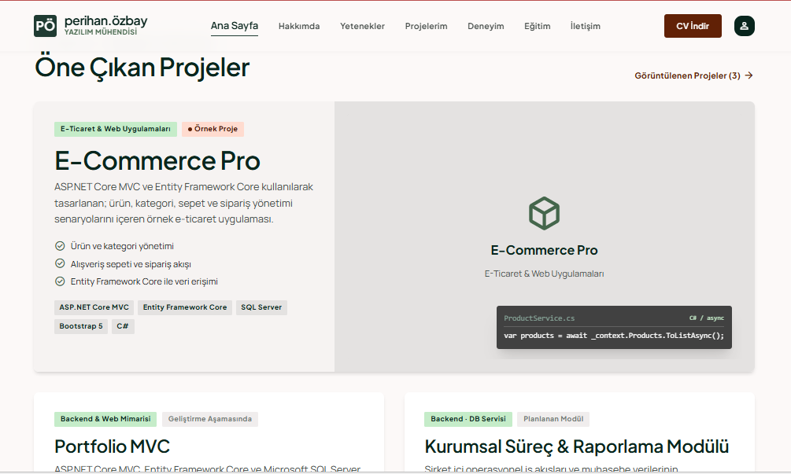

| Deneyim ve eğitim | İletişim formu |
|:--:|:--:|
| 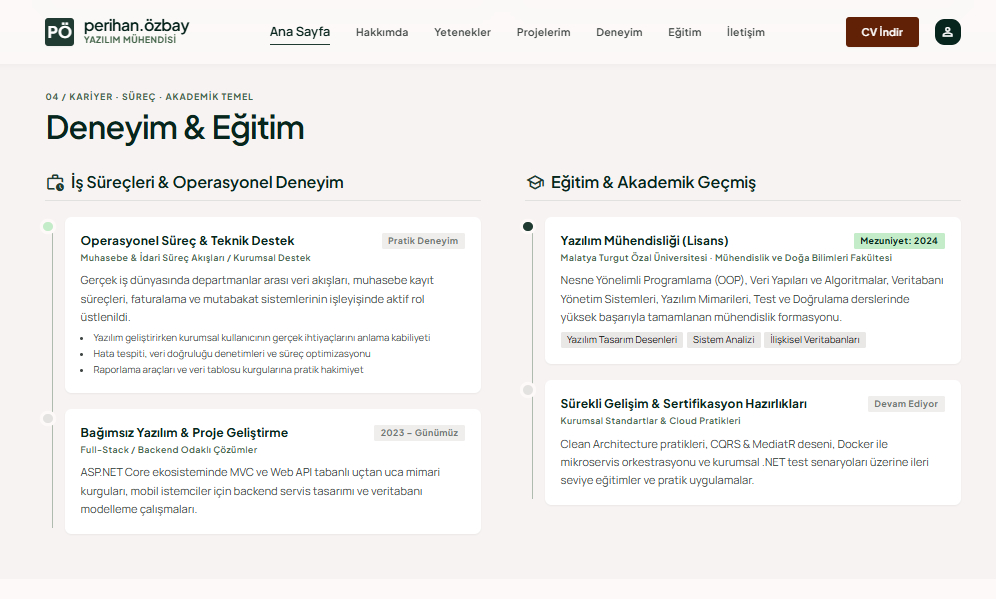 | 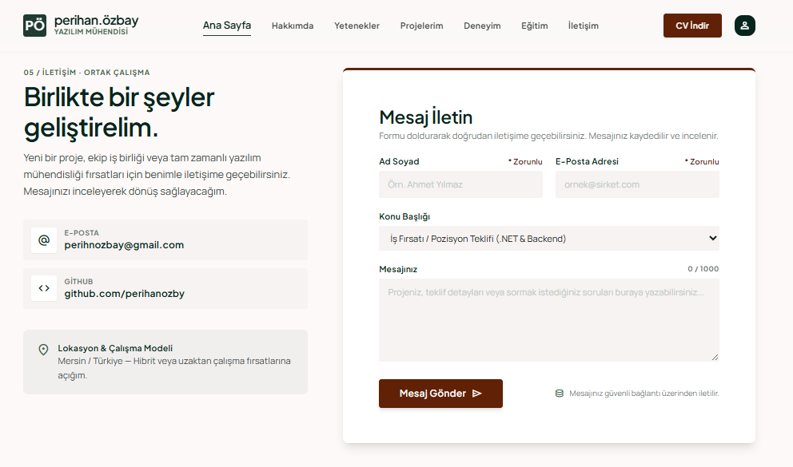 |

Public arayüzde bölüm bağlantıları, yetenek seviye çubukları, proje kartları, iletişim formu ve **PDF CV indirme** bağlantısı bulunmaktadır.

## 🛠️ Yönetim Paneli

**Dashboard:** Veritabanı verilerine dayalı toplam/aktif proje, yetenek, deneyim, eğitim, mesaj ve okunmamış mesaj istatistikleri; son mesajlar, son projeler ve hızlı işlemler.

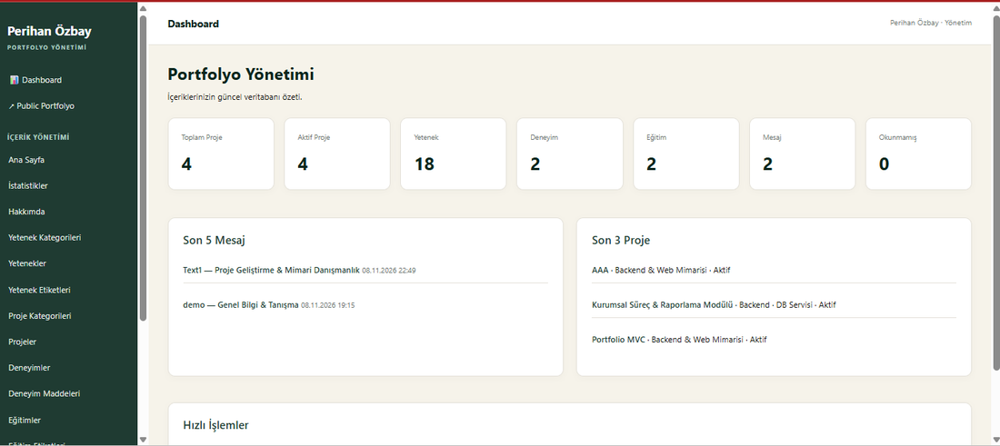

| Proje yönetimi | Mesaj yönetimi |
|:--:|:--:|
| 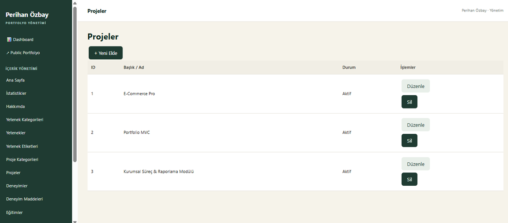 | 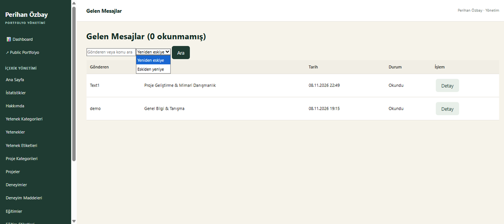 |

**İçerik modülleri:** Ana sayfa, Hakkımda, yetenekler, projeler, proje kategorileri, deneyim, eğitim, mesajlar ve ayarlar için yönetim ekranları.

- **Projeler:** Ekleme, düzenleme ve silme; kategori seçimi, aktif/pasif ve öne çıkarma alanları.
- **Mesajlar:** Gelen kutusu, gönderene/konuya göre arama, tarih sıralaması ve okundu bilgisi.
- **CV yönetimi:** PDF yükleme/güncelleme; public arayüzden dosyayı indirme.
- **Görsel yükleme:** Proje formlarında dosya seçme desteği; dosya boyutu ve türü doğrulaması için sunucu tarafı işlemler.

<strong>Ek ekranlar: CV yönetimi ve sayfa altlığı</strong>

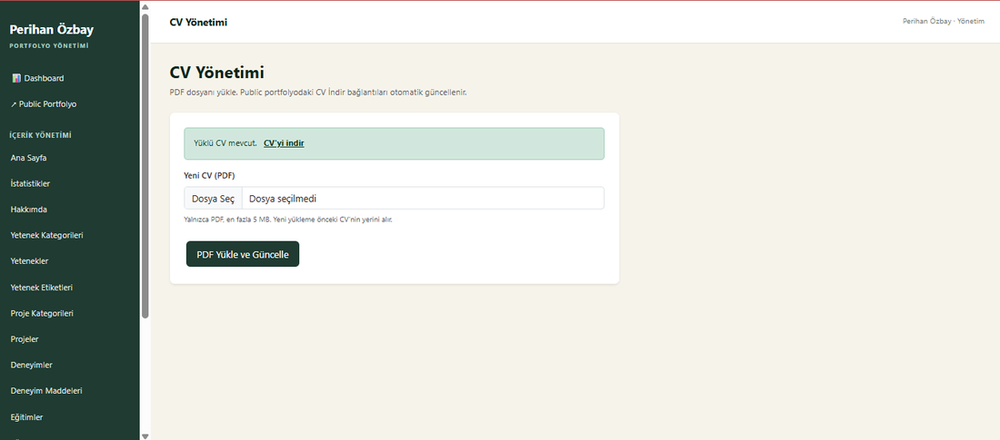

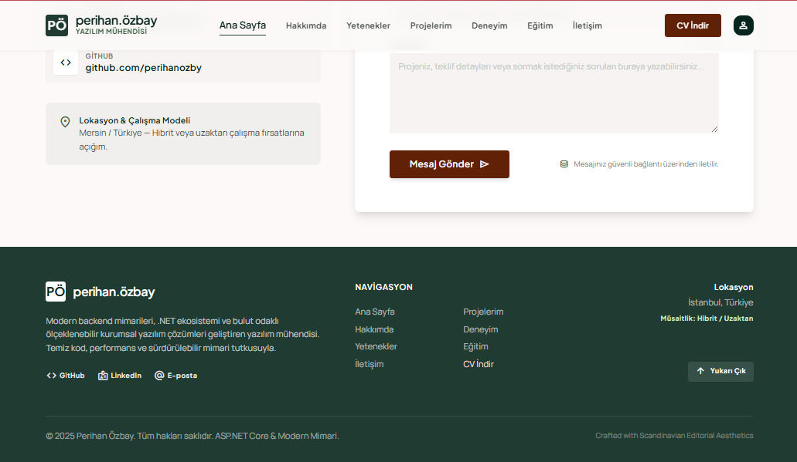

## 🗂️ Veri Modeli ve MVC Yapısı

- **MVC:** Controller, Entity/Model ve Razor View ayrımı.
- **ViewComponent:** Public sayfa bölümlerinin bileşen bazında yönetimi.
- **EF Core:** Code First, migration ve LINQ sorguları.
- **İlişkili tablolar:** `ProjectCategory (1) → (N) Project` ilişkisi; foreign key ve navigation property.
- **Formlar:** `ModelState` ve model doğrulaması, kategori dropdown'ında `SelectList` / `asp-items`.
- **Dashboard sorguları:** `Count`, `OrderByDescending`, `Take` ve ilişkili veri erişimi.

## ⚙️ Teknolojiler

`C#` · `ASP.NET Core MVC` · `Entity Framework Core` · `SQL Server` · `Razor` · `ViewComponent` · `Bootstrap` · `HTML/CSS` · `JavaScript`

## 📋 CASE 01 | Proje Kapsamı

Çalışmanın temel amacı, ASP.NET Core MVC mimarisini kullanarak statik bir portfolyo tasarımını veritabanı destekli, dinamik ve yönetilebilir bir web uygulamasına dönüştürmektir.

Proje kapsamında;

- **Dinamik içerik yönetimi:** Portfolyo bölümlerinin Admin paneli üzerinden yönetilmesi.
- **CRUD işlemleri:** Proje, kategori, eğitim, deneyim, yetenek ve diğer içeriklerin yönetimi.
- **İlişkisel veritabanı:** Entity Framework Core Code First yaklaşımı ve SQL Server entegrasyonu.
- **ViewComponent mimarisi:** Arayüz bileşenlerinin modüler ve sürdürülebilir şekilde yapılandırılması.
- **İletişim yönetimi:** Form verilerinin veritabanına kaydedilmesi ve Admin panelinden görüntülenmesi.
- **Dashboard:** Veritabanından elde edilen istatistiklerin ve son kayıtların sunulması.
- **Dosya yönetimi:** Proje görsellerinin yüklenmesi ve PDF formatında CV yönetimi.

Bu çalışma ile MVC mimarisi, ilişkisel veri yönetimi, sunucu taraflı doğrulama ve dinamik web uygulaması geliştirme konularında edinilen bilgilerin uygulamalı olarak pekiştirilmesi hedeflenmiştir.
